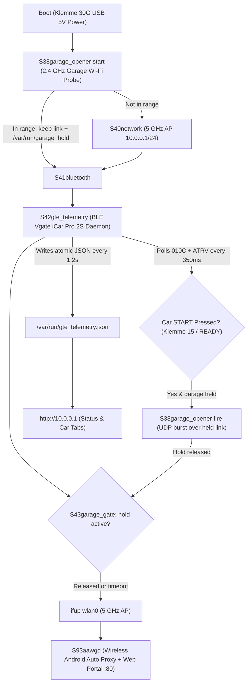

# FuteDongle — Wireless Android Auto Dongle, Smart Garage Opener & VW MQB / Passat GTE Live Telemetry

DIY Wireless Android Auto adapter built on Buildroot and Raspberry Pi (optimized for **Raspberry Pi 4 Model B** and **2020 VW Passat B8 GTE MIB3**), featuring:

1. **Native 5 GHz Wireless Android Auto Proxy (`aawgd`)** — Zero-modification AAP/GAL passthrough over 5 GHz Wi-Fi (`Channel 36`) and Linux USB Gadget (`f_accessory`), with no extra phone app required.
2. **Smart Two-Stage Garage Door Opener (`S38garage_opener`)** — Probes garage Wi-Fi availability at boot without false-triggering when unlocking the car door (`Klemme 30G`), and fires high-priority UDP trigger bursts the instant the **Car `START` button (`Klemme 15` / `READY`)** is pressed, holding the Android Auto radios off until the door has been triggered.
3. **Live VW MQB & Passat B8 GTE OBD-II / UDS Telemetry (`gte_telemetryd`)** — Persistent Bluetooth 5.2 BLE GATT client (`Vgate iCar Pro 2S` / `IOS-Vlink`) that polls standard OBD-II PIDs and Volkswagen MQB UDS modules (`7E0`, `7E1`, `7E4`, `7E5`, `710`, `714`) in real time while Android Auto runs concurrently.
4. **Local Web Control & Telemetry Portal (`http://10.0.0.1`)** — Mobile-first dashboard accessible from any browser on the `futedongle` Wi-Fi network with live **Status**, **Car (GTE Telemetry)**, **Logs**, and **Settings** tabs.

---

## Table of Contents

- [Key Features](#key-features)
- [System Architecture & Boot Sequence](#system-architecture--boot-sequence)
- [Smart Garage Door Opener (`S38garage_opener`)](#smart-garage-door-opener-s38garage_opener)
- [VW MQB & Passat B8 GTE Live Telemetry (`gte_telemetryd`)](#vw-mqb--passat-b8-gte-live-telemetry-gte_telemetryd)
- [Local Web Control Portal & REST API (`http://10.0.0.1`)](#local-web-control-portal--rest-api-http10001)
- [Configuration Reference (`/etc/aawgd.conf`)](#configuration-reference-etcaawgdconf)
- [Supported Hardware & Installation](#supported-hardware--installation)
- [Troubleshooting](#troubleshooting)

---

## Key Features

- **Seamless Wireless Android Auto**:
  - Automatic Bluetooth RFCOMM handshake (`WifiStartRequest` -> `WifiInfoResponse` -> `WifiConnectStatus`) followed by low-latency 5 GHz Wi-Fi TCP socket proxy to the car's USB headunit (`AOAP` / `f_accessory`).
  - Hardened Linux 6.6 / BlueZ 5.79 Bluetooth initialization (`BCM4345C0.hcd` patch sync, `rfkill` unblock guard, MGMT key/UUID ordering, and bounded USB `ENODEV`/`EAGAIN` retry).
- **Zero-Interference Dual-Bluetooth Architecture**:
  - `aawgd` uses Classic Bluetooth (BR/EDR RFCOMM) only during initial phone discovery and switches `hci0` to `setPairable(false)` while keeping the controller powered on after Wi-Fi handoff.
  - `gte_telemetryd` uses **Bluetooth Low Energy (BLE 5.2 GATT)** via `IOS-Vlink` (Service `0x18F0`, Write RX `0x2AF1`, Notify TX `0x2AF0`), requiring no Classic PIN pairing and avoiding RFCOMM contention.
  - `aawgd` automatically filters out Vgate/OBD adapters (`IOS-Vlink`, `Android-Vlink`, `Vgate`, `OBD`) during phone Bluetooth paging and pauses paging whenever `/var/run/garage_firing` is active.
- **Persistent Partition (`/persist`)**:
  - Stores paired Bluetooth link keys, live web portal overrides (`/persist/aawgd.conf`), and cumulative Electric (`E-Mode`) vs Hybrid (`1.4 TSI`) lifetime kilometer counters (`/persist/gte_lifetime.txt`) across reboots and read-only rootfs mounts.

---

## System Architecture & Boot Sequence

### Init Script Pipeline (`/etc/init.d/`)

| Order | Init Script / Binary | Responsibility |
| :--- | :--- | :--- |
| `S38` | `S38garage_opener` (`/usr/bin/garage_udp_send`) | Probes garage Wi-Fi availability at boot and keeps the link up when in range. Called with `fire` by `gte_telemetryd` on Car `START`, and with `release` by `S43garage_gate` on hold timeout. |
| `S39` | `S39hostapd_conf` | Generates `/var/run/hostapd.conf` for the 5 GHz (`hw_mode=a`, `channel=36`, `HT40+`) or 2.4 GHz Android Auto access point. |
| `S40` | `S40network` | Brings up `lo` and `wlan0` (`10.0.0.1/24`) and launches `hostapd` (skipped while `/var/run/garage_hold` exists). |
| `S41` | `S41bluetooth` | Loads Broadcom `hci_uart` firmware (`BCM4345C0.hcd`), brings `hci0` UP synchronously, and starts `bluetoothd`. |
| `S42` | `S42gte_telemetry` (`/usr/bin/gte_telemetryd`) | Supervises the BLE OBD-II & VW MQB UDS telemetry daemon and Car-`START` garage trigger monitor (launched early right after Bluetooth). |
| `S43` | `S43garage_gate` | If the garage Wi-Fi was found at boot, blocks the rest of the boot (no Android Auto AP, no phone Bluetooth, no `aawgd`) while `wlan0` stays associated with the garage AP, until Car `START` sends the UDP trigger or `AAWG_GARAGE_HOLD_TIMEOUT_SEC` expires; then brings up the 5 GHz AP. |
| `S80` | `S80dnsmasq` | Runs `dnsmasq` with `no-ping` for sub-100ms `DHCPOFFER` leases (`10.0.0.10` – `10.0.0.50`) and captive DNS aliases (`futedongle.local`, `dongle.local`). |
| `S93` | `S93aawgd` (`/usr/bin/aawgd`) | Supervises the core Android Auto Wireless C++ daemon and embedded HTTP Web Portal (`0.0.0.0:80`). |

---

## Smart Garage Door Opener (`S38garage_opener`)

On Volkswagen MQB vehicles (such as the Passat B8 GTE), unlocking the car with the keyfob energizes the USB data port (`Klemme 30G`) **before** the driver enters the cabin or starts the car. Opening the garage door immediately at boot would trigger the door every time the user merely unlocks the car to grab something from the cabin.

FuteDongle solves this by waiting for the **Car `START` button** and keeping every Android Auto radio off until the door has been triggered:

### 1. Boot Probe (`S38garage_opener start`)
- Associates `wlan0` to `AAWG_GARAGE_WIFI_SSID` (hidden 2.4 GHz networks supported via `scan_ssid=1`), acquires a DHCP lease and caches the frequency, IP, gateway and target ARP entries in `/var/run/garage_env`.
- **Not in range**: tears down client mode and the boot continues normally (5 GHz AP, Bluetooth, `aawgd`).
- **In range**: keeps `wpa_supplicant` and the lease alive and creates `/var/run/garage_hold`.

### 2. Hold Gate (`S43garage_gate`)
While `/var/run/garage_hold` exists, `S40network` skips `hostapd` and `S43garage_gate` blocks the rest of the boot: no Android Auto AP, no phone Bluetooth agent, no `aawgd`. Only `bluetoothd` and `gte_telemetryd` run, so the Vgate BLE link can detect the car start. The hold ends when:
- Car `START` fires the door (see below), or
- `AAWG_GARAGE_HOLD_TIMEOUT_SEC` elapses (the car was only unlocked): the hold is released **without** opening and the trigger is disarmed for this drive, or
- `gte_telemetryd` is not running, so `START` cannot be detected.

Afterwards the gate runs `ifup wlan0` and the 5 GHz AP comes up.

### 3. Trigger (`S38garage_opener fire`)
`gte_telemetryd` connects via BLE to the Vgate iCar Pro 2S. While the car is only unlocked (`Klemme 30G`), Terminal 15 is OFF (`010C` returns `NO DATA` and `ATRV` is at resting `~12.2V`). The moment the driver presses `START` (even in 100% electric `E-Mode` with `0 RPM`), Terminal 15 wakes the CAN gateway (`010C` returns `410Cxxxx` or `ATRV >= 13.5V` from the HV DC-DC converter) and `gte_telemetryd` invokes `/etc/init.d/S38garage_opener fire`, which:
1. Creates `/var/run/garage_firing` so `gte_telemetryd` pauses BLE traffic on the shared `CYW43455` radio.
2. Sends 4 bursts of DSCP `EF` (`TOS 0xb8`, `SO_PRIORITY=6`, WMM `AC_VO`) UDP datagrams via `/usr/bin/garage_udp_send` over the **already associated** garage link (re-associating on the cached frequency only if the link dropped).
3. Tears down client mode and removes the hold so `S43garage_gate` brings up Android Auto.

---

## VW MQB & Passat B8 GTE Live Telemetry (`gte_telemetryd`)

`/usr/bin/gte_telemetryd` ([`obdTelemetry.cpp`](aa_wireless_dongle/package/aawg/src/obdTelemetry.cpp)) connects over Bluetooth 5.2 BLE GATT to the **Vgate iCar Pro 2S** (`IOS-Vlink`) and writes atomic JSON snapshots to `/var/run/gte_telemetry.json`, served by `GET /api/v1/status` and rendered live in the **Car** and **Status** tabs of `http://10.0.0.1`.

### Why `IOS-Vlink`?
The Vgate iCar Pro 2S is a dual-mode Bluetooth 5.2 adapter that simultaneously advertises:
- `Android-Vlink`: Classic Bluetooth SPP (BR/EDR), requiring a legacy PIN (`1234`) and competing with Android Auto's Classic Bluetooth RFCOMM channel.
- `IOS-Vlink`: Standard **Bluetooth Low Energy (BLE 5.2 GATT)** (Service `0x18F0`, Write RX `0x2AF1`, Notify TX `0x2AF0`), which works natively with Linux BlueZ `gatttool` without PIN prompts or Classic Bluetooth interference.

### Polled ECUs, OBD-II Modes & VW MQB UDS PIDs

#### 1. Hybrid Drive Mode & HV Traction Battery (`8C` Hybrid BMS — `ATSH 7E5` / `ATCRA 7ED`)

| Metric | JSON Key | OBD / UDS PID | Formula / Details |
| :--- | :--- | :--- | :--- |
| **GTE Drive Mode** | `drive_mode` | Derived (`010C`, `010D`, `hv_kw`) | `E-Mode (100% Electric)`, `GTE Boost (TSI + Electric)`, `Hybrid (1.4 TSI + Assist)`, `Hybrid + Battery Charge`, `Regen Braking (Charge)`, `Ready (Standby)`, `Ignition On (Terminal 15)` |
| **HV Battery SoC** | `hv_soc_pct` | Mode `01` `015B` / UDS `22028C` | $\frac{100 \times A}{255}$ (`%` usable / physical SoC) |
| **HV Pack Voltage** | `hv_voltage_v` | UDS `221E3B` | $(256A + B) / 100.0\text{ V}$ (or `/ 10.0` depending on BMS firmware scaling) |
| **HV Pack Current** | `hv_current_a` | UDS `221E3D` | Signed 16-bit $(256A + B) / 10.0\text{ A}$ (positive = discharge, negative = regen/charge) |
| **HV Electric Power** | `hv_power_kw` | Derived (`V * A / 1000`) | Real-time traction/regen power in `kW` |
| **HV Battery Temp** | `hv_battery_temp_c` | UDS `222A0B` | $(A - 40)\text{ }^\circ\text{C}$ (9.9 / 13.0 kWh pack temperature) |
| **96s Cell Voltage Min / Max** | `hv_cell_min_v`, `hv_cell_max_v` | UDS `221E33`, `221E34` | $(256A + B) / 1000.0\text{ V}$ (`1.0 V` – `4.5 V` per cell) |
| **Cell Imbalance ($\Delta\text{mV}$)** | `hv_cell_delta_mv` | Derived | $(\text{Cell}_{\max} - \text{Cell}_{\min}) \times 1000\text{ mV}$ (`< 20 mV` balanced, `> 50 mV` imbalance alert) |
| **HV Battery SOH** | `hv_soh_pct` | UDS `221E32` | State of Health (`%`) of the lithium-ion traction pack |

#### 2. Electric Drive Module `51` (`J841` — `ATSH 7E4` / `ATCRA 7EC`) & System Output

| Metric | JSON Key | OBD / UDS PID | Formula / Details |
| :--- | :--- | :--- | :--- |
| **Inverter Temperature** | `inverter_temp_c` | UDS `221E12` | Power electronics inverter temperature in `°C` |
| **E-Machine (`HEM80`) RPM** | `emotor_rpm` | UDS `221E10` / K0 clutch sync | Electric traction motor speed (`RPM`) |
| **Combined GTE Output** | `system_total_cv`, `system_total_kw` | Derived (`hv_power_kw` + TSI load/RPM) | Combined hybrid power up to **218 CV (160 kW)** in *GTE Boost* |

#### 3. 1.4 TSI EA211 GDI Turbo Engine (`01` Engine ECM — `7DF` / `ATSH 7E0` -> `7E8`)

| Metric | JSON Key | OBD / UDS PID | Formula / Details |
| :--- | :--- | :--- | :--- |
| **Engine RPM** | `rpm` | Mode `01` `010C` | $(256A + B) / 4\text{ RPM}$ (`0 RPM` in `E-Mode`) |
| **Vehicle Speed** | `speed_kmh` | Mode `01` `010D` | $A\text{ km/h}$ |
| **Coolant Temperature** | `coolant_c` | Mode `01` `0105` | $(A - 40)\text{ }^\circ\text{C}$ |
| **Engine Oil Temperature** | `oil_c` | Mode `01` `015C` | $(A - 40)\text{ }^\circ\text{C}$ |
| **Cold-Engine Thermal Guard** | UI Warning Badge | Derived (`rpm > 0` & temp `< 70 °C`) | Alerts `COLD TSI (<70°C) — Avoid Kickdown` when the 1.4 TSI starts cold during hybrid kickdown |
| **Engine Load** | `engine_load_pct` | Mode `01` `0104` | $\frac{100 \times A}{255}\text{ \%}$ |
| **Turbo Boost Pressure** | `boost_bar`, `map_kpa`, `baro_kpa` | Mode `01` `010B`, `0133` | Relative boost $(\text{MAP} - \text{Baro}) / 100.0\text{ bar}$ |
| **Intake Air Temp (IAT)** | `intake_c` | Mode `01` `010F` | $(A - 40)\text{ }^\circ\text{C}$ (charge-air cooler efficiency) |
| **Throttle Position** | `throttle_pct` | Mode `01` `0111` | $\frac{100 \times A}{255}\text{ \%}$ |
| **GDI Fuel Rail Pressure** | `rail_pressure_bar` | Mode `01` `0123` | $(256A + B) \times 0.1\text{ bar}$ (`40 bar` idle up to `200 bar` full load) |
| **Ignition Spark Advance** | `timing_advance_deg` | Mode `01` `010E` | $(A / 2.0) - 64.0\text{ }^\circ\text{BTDC}$ |
| **Fuel Trims (STFT / LTFT)** | `stft_pct`, `ltft_pct` | Mode `01` `0106`, `0107` | $(A - 128) \times \frac{100}{128}\text{ \%}$ (Bank 1 short-term and long-term mixture adaptation) |
| **Catalyst Bank 1 Temp** | `cat_temp_c` | Mode `01` `013C` | $((256A + B) / 10.0) - 40.0\text{ }^\circ\text{C}$ |
| **Instant Fuel Rate** | `fuel_rate_lh`, `fuel_l100km` | Mode `01` `015E` | $(256A + B) / 20.0\text{ L/h}$ and live $\text{L/100 km}$ while moving |
| **ICE Runtime Since Start** | `ice_runtime_sec` | Mode `01` `011F` | $256A + B\text{ seconds}$ of thermal engine operation |

#### 4. DQ400e 6-Speed DSG Transmission (`02` TCM — `ATSH 7E1` / `ATCRA 7E9`)

| Metric | JSON Key | OBD / UDS PID | Formula / Details |
| :--- | :--- | :--- | :--- |
| **DSG Oil Temperature** | `dsg_temp_c` | UDS `22F405` | $(A - 40)\text{ }^\circ\text{C}$ (wet dual-clutch & mechatronic fluid temperature) |
| **Active Gear Estimate** | `dsg_gear` | Derived (`speed_kmh`, `emotor_rpm`, `rpm`) | Estimates active DQ400e gear (`P/N`, `D1` .. `D6`) from shaft speed ratios |

#### 5. Electric vs Hybrid Kilometer Split, Odometer & Range (`17` Cluster — `ATSH 714` / `ATCRA 77E`)

| Metric | JSON Key | Source / PID | Details |
| :--- | :--- | :--- | :--- |
| **Trip Electric vs Hybrid km** | `trip_ev_km`, `trip_ice_km`, `trip_total_km`, `trip_ev_pct` | Time-integrated $v(t)\,\Delta t$ | Integrates distance traveled with `rpm == 0` (`E-Mode`) vs `rpm > 0` (`1.4 TSI`) and computes Zero-Emission `%` |
| **Lifetime Electric vs Hybrid km** | `lifetime_ev_km`, `lifetime_ice_km`, `lifetime_total_km`, `lifetime_ev_pct` | `/persist/gte_lifetime.txt` | Persisted to flash every `0.25 km` and when the car turns off (`Klemme 15` OFF) |
| **Vehicle Odometer** | `odometer_km` | Mode `01` `01A6` / UDS `714` `222203` | Standard OBD `01A6` ($0.1\text{ km}$ resolution) with automatic fallback to Instrument Cluster `17` UDS `222203` |
| **Distance Since DTC Cleared** | `km_since_dtc_clear` | Mode `01` `0131` | $256A + B\text{ km}$ since fault codes were last reset |
| **Distance With MIL On** | `km_with_mil_on` | Mode `01` `0121` | $256A + B\text{ km}$ driven with Check Engine light active |
| **EV Range / Fuel Range / Total Range** | `ev_range_km`, `fuel_range_km`, `total_range_km` | Derived (`hv_soc_pct`, `fuel_level_pct`) | Usable GTE electric range (`~48 km` at 100% SoC) + gasoline range (`50 L` tank at `~6.0 L/100km`) |
| **Fuel Tank Level** | `fuel_level_pct`, `fuel_liters` | Mode `01` `012F` | $\frac{100 \times A}{255}\text{ \%}$ and liters remaining (50 L Passat GTE tank) |

#### 6. 12V Network (`19` CAN Gateway `J533` — `ATSH 710` / `ATCRA 77A`), Diagnostics & GPS

| Metric | JSON Key | Source / PID | Details |
| :--- | :--- | :--- | :--- |
| **12V Terminal 30 Voltage** | `aux_12v` | ELM327 `ATRV` | Resting battery voltage (`~12.2V`) vs active HV-to-12V DC-DC charging voltage (`~14.1V`) |
| **ECU Control Module Voltage** | `ecu_voltage_v` | Mode `01` `0142` | $(256A + B) / 1000.0\text{ V}$ at the engine control unit |
| **12V AGM Battery SoC** | `aux_12v_soc_pct` | UDS `710` `222B01` | State of Charge (`%`) of the 12V trunk AGM battery monitored by `J367/J533` |
| **Active Fault Codes (DTC)** | `dtc_count`, `dtc_codes` | Mode `03` (`03`) | Decodes active powertrain trouble codes (`Pxxxx`, `Cxxxx`, `Bxxxx`, `Uxxxx`) |
| **Chassis VIN** | `vin` | Mode `09` (`0902`) | 17-character vehicle identification number (`WVWZZZ3CZ...`) |
| **Parked Car GPS Location** | `gps_lat`, `gps_lon`, `gps_acc_m`, `gps_updated_at` | `POST /api/v1/gps` (`/persist/gte_gps.json`) | Saves phone browser geolocation alongside the current odometer reading with a direct Google Maps link |

---

## Local Web Control Portal & REST API (`http://10.0.0.1`)

When connected to the `futedongle` Wi-Fi network (or via captive DNS `http://futedongle.local`), the embedded HTTP server ([`webPortal.cpp`](aa_wireless_dongle/package/aawg/src/webPortal.cpp)) serves a single-page application ([`index.html`](aa_wireless_dongle/board/common/rootfs_overlay/usr/share/futedongle-web/index.html)) with four tabs:

1. **Status**: Wireless Android Auto session state, phone Bluetooth/Wi-Fi peer info, garage trigger badge, quick GTE battery/fuel summary, and one-tap system actions (**Test Garage Open**, **Restart AA**, **Reset Bluetooth Pairings**, **Reboot Dongle**).
2. **Car (Passat GTE Live OBD2)**: Full real-time dashboard covering HV Traction Battery, 1.4 TSI GDI & DQ400e DSG temperatures/pressures/trims, Electric vs Hybrid kilometer split (trip & lifetime), Odometer, DTC scanner, VIN, and Parked Car GPS Pinning.
3. **Logs**: Live tail of `/var/log/messages`, `/var/log/aawgd.log`, and `/var/log/gte_telemetry.log` with one-tap copy.
4. **Settings**: Web form to configure Wi-Fi/Bluetooth names, connection strategy, Garage Opener Wi-Fi/UDP target, and Vgate BLE telemetry (`AAWG_ENABLE_OBD_TELEMETRY`, optional `AAWG_OBD_BLE_MAC`), persisted directly to `/persist/aawgd.conf`.

### HTTP REST Endpoints

| Method & Path | Description |
| :--- | :--- |
| `GET /api/v1/status` | Returns dongle runtime telemetry, USB/Wi-Fi/BT state, garage opener status, and the embedded `obd` object from `/var/run/gte_telemetry.json` + `/persist/gte_gps.json`. |
| `POST /api/v1/gps` | Persists parked car GPS coordinates (`{"lat": ..., "lon": ..., "acc": ...}`) and current odometer to `/persist/gte_gps.json`. |
| `GET /api/v1/logs` | Returns recent system, `aawgd`, garage opener, and `gte_telemetryd` logs. |
| `GET /api/v1/config` | Returns the active configuration key-value pairs from `/etc/aawgd.conf` and `/persist/aawgd.conf`. |
| `POST /api/v1/config` | Validates and writes updated configuration settings to `/persist/aawgd.conf` and `/boot/aawgd.conf`. |
| `POST /api/v1/action/garage-test` | Manually triggers `/etc/init.d/S38garage_opener test` to test garage door opening. |
| `POST /api/v1/action/restart-aa` | Restarts the `aawgd` proxy session. |
| `POST /api/v1/action/clear-bt` | Clears paired Bluetooth devices from `/persist/bluetooth` and restarts Bluetooth discovery. |
| `POST /api/v1/action/reboot` | Cleanly reboots the dongle. |

---

## Configuration Reference (`/etc/aawgd.conf`)

Configuration is loaded from `/etc/aawgd.conf`, overridden by `/boot/aawgd.conf` (FAT32 `WirelessAA` partition) and `/persist/aawgd.conf` (saved via the Web Portal).

| Variable | Default | Description |
| :--- | :--- | :--- |
| `AAWG_COUNTRY_CODE` | `ES` | ISO/IEC 3166-1 regulatory domain for 5 GHz / 2.4 GHz Wi-Fi channels. |
| `AAWG_CONNECTION_STRATEGY` | `1` | `0`: Dongle mode, `1`: Phone first (default), `2`: USB first. |
| `AAWG_EARLY_USB_VERSION_EXCHANGE` | `0` | `1` enables early AOAP version exchange with the headunit prior to phone Wi-Fi handoff. |
| `AAWG_BLUETOOTH_NAME` | `futedongle` | Bluetooth alias advertised to the phone. |
| `AAWG_WIFI_SSID` | `futedongle` | 5 GHz Wi-Fi Access Point SSID used for Wireless Android Auto and Web Portal access. |
| `AAWG_WIFI_PASSWORD` | `'ConnectAAWirelessDongle'` | Fixed WPA2 passphrase so phone Wi-Fi profiles persist across reboots. |
| `AAWG_ENABLE_SSH` | `0` (`#1`) | Enables Dropbear SSH server on port `22` (`root` / `password`). |
| `AAWG_ENABLE_DEBUG_LOG` | `0` | Captures 6 boot diagnostic snapshots to `/boot/car_debug.log` during the first 90 seconds. |
| `AAWG_ENABLE_WEB_PORTAL` | `1` | Enables the Local Web Control & Telemetry Portal at `http://10.0.0.1`. |
| `AAWG_ENABLE_GARAGE_OPEN` | `1` | Enables `S38garage_opener`. |
| `AAWG_GARAGE_WIFI_SSID` | `'MyGarageWiFi'` | Garage Wi-Fi SSID to associate with when firing the UDP trigger. |
| `AAWG_GARAGE_WIFI_HIDDEN` | `1` | `1` if the garage Wi-Fi SSID is hidden (`scan_ssid=1`), `0` if broadcast. |
| `AAWG_GARAGE_WIFI_BAND` | `2.4` | Frequency scan filter (`2.4`, `5`, or `all`) to speed up hidden SSID discovery. |
| `AAWG_GARAGE_WIFI_PASSWORD` | `'miPassFake'` | WPA2 password for the garage Wi-Fi network. |
| `AAWG_GARAGE_UDP_HOST` | `192.168.1.50` | Target IP address of the garage door controller. |
| `AAWG_GARAGE_UDP_PORT` | `9876` | Target UDP port of the garage door controller. |
| `AAWG_GARAGE_UDP_PAYLOAD` | `'OPEN_GARAGE'` | ASCII payload transmitted in the DSCP `EF` UDP burst. |
| `AAWG_GARAGE_TIMEOUT_SEC` | `8` | Maximum association timeout (seconds) before falling back to the 5 GHz Android Auto AP. |
| `AAWG_GARAGE_HOLD_TIMEOUT_SEC` | `120` | Max wait for Car `START` during the hold; on expiry the trigger is disarmed and Android Auto starts. |
| `AAWG_ENABLE_OBD_TELEMETRY` | `1` | Enables `/usr/bin/gte_telemetryd` (`S42gte_telemetry`). |
| `AAWG_OBD_BLE_MAC` | *(Auto-discover)* | Optional fixed BLE MAC address (e.g., `D2:E0:2F:8D:5C:7B`) for the Vgate iCar Pro 2S (`IOS-Vlink`) to skip BLE scanning on boot. |

---

## Supported Hardware & Installation

### Supported Boards
- **Raspberry Pi 4 Model B** *(Primary target — connect via the USB-C port for both power and USB 2.0 OTG data to the car's MIB3 USB port)*
- **Raspberry Pi Zero W / Zero 2 W** *(Use the micro-USB port marked `USB`, not `PWR`)*
- **Raspberry Pi 3 A+** *(Use the USB-A port with a USB-A to USB-A data cable)*

### Supported OBD-II BLE Adapter
- **Vgate iCar Pro 2S (Bluetooth 5.2 BLE V2.3)** — Plugged permanently into the Passat B8 GTE OBD-II port under the driver's dashboard. Features automatic sleep (`< 3 mA`) and wake on CAN/BLE activity.

### Installation
1. Download the pre-built SD card artifact (`raspberrypi4-sdcard.img.xz`) from **GitHub Actions** or build locally following [BUILDING.md](BUILDING.md).
2. Flash the image onto a microSD card using Raspberry Pi Imager, BalenaEtcher, or `dd`.
3. *(Optional)* Mount the `WirelessAA` boot partition and edit `aawgd.conf` (or configure everything later from `http://10.0.0.1` -> **Settings**).
4. Plug the Vgate iCar Pro 2S into the car's OBD-II port and connect the Raspberry Pi 4 via a data-capable USB-C cable to the car's Android Auto USB port.
5. Pair your phone with Bluetooth device **`futedongle`** once; subsequent connections and Car-`START` garage triggers happen automatically.

---

## Troubleshooting

### Checking Live Telemetry & Logs
1. While your phone is connected to the `futedongle` Wi-Fi network (note: disable Mobile Data temporarily if your phone routes `10.0.0.1` over cellular, or browse to `http://10.0.0.1`), open the **Status**, **Car**, or **Logs** tab.
2. Check the **Vgate iCar Pro 2S BLE** badge in the **Car** tab:
   - `Connected (IOS-Vlink)`: Active BLE GATT link and live MQB CAN polling.
   - `Scanning BLE (IOS-Vlink)...`: Ensure the Vgate LED is powered and no phone app (such as Car Scanner or Torque) is currently holding an exclusive BLE connection to `IOS-Vlink`.

### Bluetooth and Wi-Fi Connect, but Headunit Stuck at "Looking for Android Auto"
- Ensure you are using a high-quality **USB data cable** plugged into the Raspberry Pi's OTG-capable port (the USB-C port on Raspberry Pi 4).
- If you reset pairings on your phone, open `http://10.0.0.1` -> **Status** -> **Reset Bluetooth Pairings** so both sides establish a clean bond.
