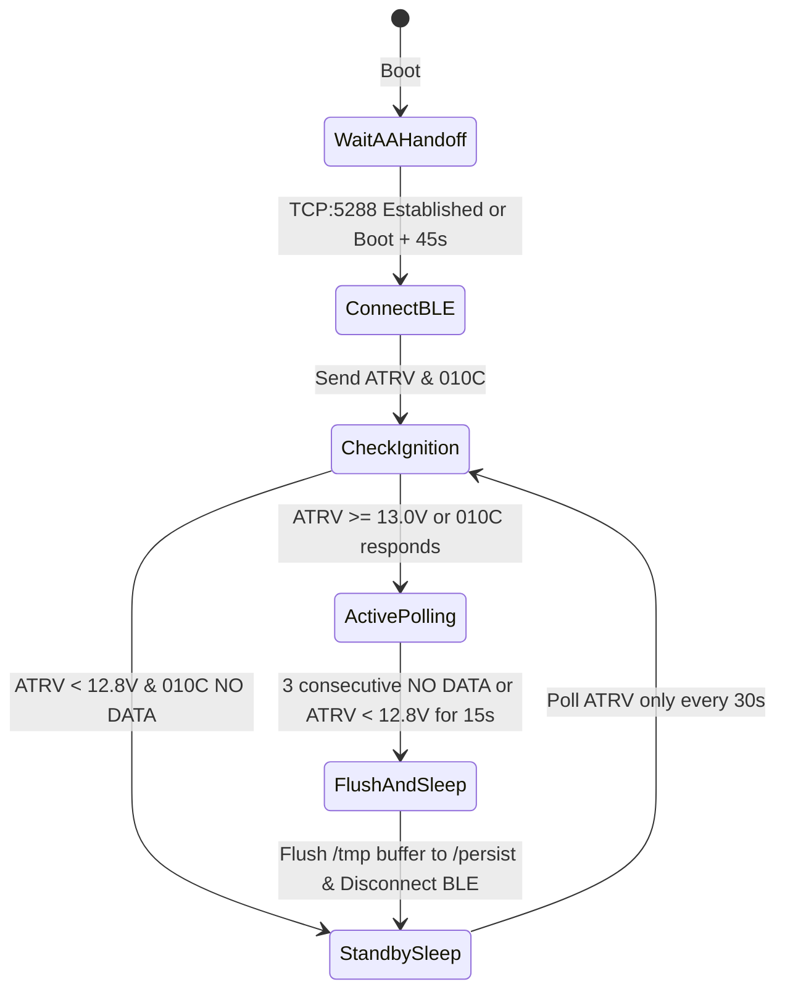

# Feature 01: VW Passat B8 GTE OBD-II BLE Telemetry & Hybrid Blackbox

## 1. Problem Statement & Objective

The **2020 Volkswagen Passat B8 GTE (Facelift, MQB platform)** is a plug-in hybrid electric vehicle (PHEV) combining a 1.4 TSI engine (EA211) with a 13 kWh gross (10.4 kWh net) high-voltage lithium-ion traction battery and DQ400e 6-speed DSG transmission.

Standard Android Auto does not expose granular hybrid diagnostics (true High-Voltage State of Charge vs dashboard SoC, HV cell temperature spread, instantaneous regenerative vs friction braking, battery capacity degradation, or 12V auxiliary battery voltage sag). Meanwhile, the Volkswagen *We Connect* cloud API is rate-limited, requires an active subscription, and does not record high-frequency per-second trip telemetry.

**Objective**: Build a lightweight background daemon (`gte_telemetryd`) on the Raspberry Pi 4 that connects over **Bluetooth Low Energy (BLE GATT)** to a low-power OBD-II adapter left plugged into the Passat's diagnostic port, polls standard OBD-II and VW MQB UDS (`0x22` `ReadDataByIdentifier`) PIDs during drives, exposes live metrics in `/run/gte_telemetry.json`, and archives compressed trip logs into `/persist/telemetry/trips/`.

---

## 2. Hardware & Bluetooth Coexistence Architecture

### 2.1 Recommended OBD-II BLE Hardware
To prevent 12V battery drain when the Passat is parked and locked, the OBD-II adapter must support automatic low-power sleep (< 1–3 mA standby) and wake on CAN activity:
- **Vgate iCar Pro BLE 4.0** (Dual-mode BLE GATT, auto-sleep after 30 minutes of CAN inactivity).
- **OBDLink CX (BLE 5.1)** (Ultra-low standby current, hardware CAN filtering).

> [!CAUTION]
> Never use cheap unbranded ELM327 v2.1 Classic Bluetooth (SPP) clones. They lack sleep mode, draw 40–80 mA continuously from Terminal 30 (permanent 12V), and contend with Classic Bluetooth (`RFCOMM` / `HSP`) airtime during Android Auto handoff.

### 2.2 BlueZ Coexistence with `aawgd`
The Raspberry Pi 4's Cypress **CYW43455** controller handles Classic Bluetooth (BR/EDR) and Bluetooth Low Energy (LE) simultaneously via BlueZ (`bluetoothd`). However, initiating a BLE scan while `aawgd` is performing the initial Classic Bluetooth RFCOMM handshake with the phone can delay link setup.

**Mandatory Coexistence Rules for `gte_telemetryd`**:
1. **Startup Delay & Handoff Guard**:
   - `gte_telemetryd` must wait until either:
     - `aawgd` has established the active TCP proxy session on port `5288` (`ss -tn state established '( sport = :5288 )'` is non-empty), **OR**
     - 45 seconds have elapsed since boot.
2. **Direct MAC Connection (No Continuous Scanning)**:
   - Once the OBD-II BLE MAC address (`AAWG_OBD_BLE_MAC`) is configured in `/boot/aawgd.conf`, `gte_telemetryd` connects directly via BlueZ DBus `org.bluez.Device1.Connect()` without starting a wideband `StartDiscovery` scan (or scans for at most 5 seconds with `Transport = "le"` filter if needed).
3. **BLE GATT Service & Characteristics**:
   - **Vgate iCar Pro BLE 4.0**:
     - Service UUID: `000018f0-0000-1000-8000-00805f9b34fb` (or `0000fff0-0000-1000-8000-00805f9b34fb`)
     - RX Notify Characteristic (Adapter -> Pi): `00002af0-...` (or `0000fff1-...`)
     - TX Write Characteristic (Pi -> Adapter): `00002af1-...` (or `0000fff2-...`)

---

## 3. ELM327 Initialization & VW MQB / GTE UDS Protocol

The Passat B8 GTE diagnostic port connects to the **J533 Data Bus Diagnostic Interface (CAN Gateway)** over **ISO 15765-4 CAN (11-bit ID, 500 kbaud)**.

### 3.1 Adapter Initialization Sequence
Upon opening the BLE GATT characteristics, `gte_telemetryd` sends the following AT commands (terminated by `\r`, waiting for the `>` prompt after each command):

| Step | Command | Purpose |
| :--- | :--- | :--- |
| 1 | `ATZ` | Reset ELM327 state machine |
| 2 | `ATE0` | Disable command echo (reduces BLE payload size by 50%) |
| 3 | `ATL0` | Disable linefeeds |
| 4 | `ATS0` | Disable spaces in hex responses for faster parsing |
| 5 | `ATH0` | Disable CAN headers during normal polling |
| 6 | `ATSP6` | Force ISO 15765-4 CAN (11-bit ID, 500 kbps) |
| 7 | `ATAT1` | Enable adaptive timing |
| 8 | `ATST32` | Set CAN response timeout to ~200 ms (`0x32` x 4 ms) |

### 3.2 ECU CAN Identifiers (MQB Platform)
To query specific control modules on the Passat B8 GTE using UDS Service `0x22` (`ReadDataByIdentifier`), switch the functional/physical CAN transmit header (`ATSH <TX_ID>`) and receive filter (`ATCRA <RX_ID>`):

| Control Module | VW Address | CAN TX Header (`ATSH`) | CAN RX Filter (`ATCRA`) | Responsibility |
| :--- | :--- | :--- | :--- | :--- |
| **Engine Control Module (J623 - 1.4 TSI)** | `01` | `7E0` | `7E8` | RPM, coolant temp, oil temp, fuel rate, combustion status |
| **Hybrid Battery Management (J840 / BMC)** | `8C` | `7E5` (or `715`) | `7ED` (or `77F`) | HV SoC (gross/net), HV pack voltage/current, cell temps, SOH |
| **Electric Drive / Power Electronics (J841)** | `51` | `7E4` | `7EC` | E-machine RPM, inverter temperature, regen torque |
| **Data Bus OBD Gateway (J533)** | `19` | `710` | `77A` | 12V battery voltage/current/SoC, odometer, ignition state |

### 3.3 Polling Tiers & PID Schedule

To keep BLE GATT traffic light (< 15 commands/second), `gte_telemetryd` groups PIDs into three tiers:

#### Tier 1: Fast Loop (Every 2 Seconds) — Driving & Power Flow
- **Adapter Voltage**: `ATRV` -> 12V bus voltage at OBD port (e.g., `14.1V` when DC-DC converter is active, `< 12.7V` when ignition is off).
- **Vehicle Speed**: Mode `010D` (`A` km/h).
- **ICE Engine Speed**: Mode `010C` (`((A*256)+B)/4` RPM — `0` when driving in pure `E-Mode`).
- **HV Battery Instantaneous Current & Voltage** (`ATSH 7E5`):
  - UDS `22 1E 3B`: High-Voltage Battery Pack Voltage ($V_{\text{HV}}$)
  - UDS `22 1E 3D`: High-Voltage Battery Pack Current ($I_{\text{HV}}$, negative = discharging/driving, positive = charging/regen)
  - Derived Instantaneous Electrical Power:
    $$P_{\text{HV}} \text{ (kW)} = \frac{V_{\text{HV}} \times I_{\text{HV}}}{1000}$$

#### Tier 2: Medium Loop (Every 15 Seconds) — State of Charge & Thermal
- **HV Battery Net/Displayed SoC**: Mode `015B` (`A * 100 / 255` %).
- **HV Battery Gross SoC & Cell Temperatures** (`ATSH 7E5`):
  - UDS `22 02 8C`: Actual HV State of Charge (0.1% resolution).
  - UDS `22 1E 0E` / `22 2A 0B`: HV Battery Module Temperature Min / Max (°C).
- **ICE Coolant & Oil Temperature** (`ATSH 7E0`):
  - Mode `0105`: Coolant temperature (`A - 40` °C).
  - Mode `015C`: Engine oil temperature (`A - 40` °C — critical on GTE when the 1.4 TSI kicks in cold during highway kickdown).
- **Ambient Air Temperature**: Mode `0146` (`A - 40` °C).

#### Tier 3: Slow Loop (Every 60 Seconds) — Odometer & Battery Health
- **Odometer**: Mode `01A6` (or Gateway `22 22 03` in km).
- **HV Usable Energy Content / SOH** (`ATSH 7E5`, UDS `22 1E 32`): Remaining maximum charge capacity in Ah / Wh to track long-term GTE battery degradation.

---

## 4. Ignition-Off & Anti-Drain State Machine

On the VW Passat B8, the MIB3 USB-C port remains powered for ~2–5 minutes after the driver turns off the ignition and locks the car. Polling UDS Mode `22` while the car is locked can keep the CAN Gateway (`J533`) awake.

`gte_telemetryd` must enforce the following state machine:



1. If `010C` (RPM) or `010D` (Speed) returns `NO DATA` / `UNABLE TO CONNECT` three times in a row, **OR** `ATRV` drops below `12.8V` (indicating the HV-to-12V DC-DC converter has shut off because Terminal 15 ignition is OFF):
2. Immediately stop all CAN bus queries (`01..` / `22..`).
3. Flush the in-memory trip buffer (`/tmp/current_trip.jsonl`) to `/persist/telemetry/trips/` and call `sync()`.
4. Send `ATLP` (ELM327 low-power mode) and disconnect the BLE GATT link so the OBD-II dongle enters hardware sleep.

---

## 5. Data Storage Schema (`/persist` & `/run`)

### 5.1 Live Snapshot (`/run/gte_telemetry.json` on `tmpfs`)
Updated every 2 seconds via atomic write (`/run/gte_telemetry.json.tmp` -> `rename()`) for zero-latency consumption by the Local Web Portal (Feature 02) and Home Assistant Sync (Feature 03):

```json
{
  "timestamp_utc": "2026-11-04T20:15:30Z",
  "ignition_on": true,
  "drive_mode": "E-MODE",
  "speed_kmh": 64,
  "ice_rpm": 0,
  "ice_coolant_c": 24,
  "ice_oil_c": 22,
  "ambient_c": 14,
  "hv_soc_display_pct": 78.4,
  "hv_soc_gross_pct": 74.1,
  "hv_voltage_v": 352.4,
  "hv_current_a": -34.2,
  "hv_power_kw": -12.05,
  "hv_temp_min_c": 18.5,
  "hv_temp_max_c": 20.0,
  "aux_12v_v": 14.2,
  "trip": {
    "start_utc": "2026-11-04T20:00:12Z",
    "distance_km": 11.4,
    "electric_kwh_used": 1.82,
    "regen_kwh_recovered": 0.41,
    "ice_runtime_sec": 0
  }
}
```

### 5.2 Persistent Trip Archive (`/persist/telemetry/trips/`)
- **Buffered in RAM**: Samples are appended to `/tmp/trip_active.jsonl` every 2–15 seconds.
- **Periodic Flush**: Every 60 seconds (and upon ignition-off), new lines from `/tmp/trip_active.jsonl` are appended to `/persist/telemetry/trips/trip_<YYYYMMDD_HHMMSS>.jsonl`.
- **Trip Summary Index**: `/persist/telemetry/trips_index.jsonl` stores one summary JSON object per completed drive (start/end time, distance, electric kWh/100km, average speed, start/end SoC %, max HV cell temp).
- **Storage Footprint**: At ~180 bytes per sample every 5 seconds, a 1-hour commute uses ~130 KB raw (~25 KB gzipped). Even 10,000 hours of driving consumes < 250 MB on the 64 GB SD card.

---

## 6. Buildroot & Configuration Integration

### 6.1 Configuration Flags in `/boot/aawgd.conf`
```ini
## Enable VW Passat GTE OBD-II BLE Telemetry Daemon
AAWG_ENABLE_OBD_TELEMETRY=0

## Bluetooth LE MAC address of the OBD-II adapter (e.g., Vgate iCar Pro BLE)
#AAWG_OBD_BLE_MAC=00:1D:A5:XX:XX:XX
```

### 6.2 Buildroot Package Layout
Create a new C++17 daemon package (reusing `dbus-cxx` already compiled in Buildroot for `aawgd` so zero new library dependencies are required):
- `aa_wireless_dongle/package/aawg/src/obdTelemetry.h` & `obdTelemetry.cpp` (or standalone binary `/usr/bin/gte_telemetryd` built in `aa_wireless_dongle/package/aawg/src/CMakeLists.txt`).
- Init script `aa_wireless_dongle/board/common/rootfs_overlay/etc/init.d/S94gte_telemetry`:
  - Checks `AAWG_ENABLE_OBD_TELEMETRY=1` and `AAWG_OBD_BLE_MAC`.
  - Starts `/usr/bin/gte_telemetryd` with `nice -n 10` via `start-stop-daemon`.

