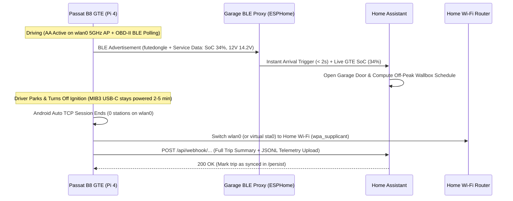

# Feature 03: Home Garage Auto-Sync, Home Assistant Integration & GTE Smart Charging

## 1. Problem Statement & Objective

When the **2020 VW Passat B8 GTE** returns to the home garage:
1. The driver wants **Home Assistant** to know immediately that the Passat has arrived (to open the garage door, turn on garage lighting, or disarm garage motion zones).
2. Home Assistant needs the **exact High-Voltage (HV) battery State of Charge (`hv_soc_gross_pct` / `hv_soc_display_pct`)** captured by Feature 01 (`gte_telemetryd`) so it can schedule the home Wallbox charger during off-peak electricity hours (*tarifa valle*) and calculate the exact kWh and charging duration needed.
3. All completed trip logs stored in `/persist/telemetry/trips/` should be automatically offloaded to the home server over Wi-Fi without ever removing the SD card.

---

## 2. Radio Architecture: Solving the Single-Chip Wi-Fi Constraint

The Raspberry Pi 4 Model B uses a single Cypress **CYW43455** (`brcmfmac`) 802.11ac + Bluetooth 5.0 chip.
While the car is being driven and Android Auto is active, `wlan0` operates in **Access Point (`AP`) mode on 5 GHz Channel 36** (`ssid=futedongle`).

Attempting to switch `wlan0` channels or run heavy background Wi-Fi scans while Android Auto is streaming H.264 video over TCP port `5288` will cause packet loss and video stuttering. Therefore, we separate **Instant Arrival Detection (BLE)** from **Post-Drive Data Offload (Wi-Fi Client Handoff)**.



---

## 3. Three-Stage Synchronization & Garage Door Protocol

### Stage 0 (Implemented): Boot-Time Departure Trigger over Hidden 2.4 GHz Wi-Fi + UDP (`S38garage_opener`)
When the driver unlocks/starts the Passat inside the community garage (next to the storage room `trastero` AP), the MIB3 USB-C port supplies 5V power to the Raspberry Pi 4 **before** any Android Auto session begins:

1. **Strict Pre-AP Ordering (`S38` < `S39` < `S40`)**:
   - `/etc/init.d/S38garage_opener` runs synchronously **before** `S39hostapd_conf` and `S40network` ever touch `wlan0`.
   - If `hostapd` is already running (`pidof hostapd`), `S38garage_opener` refuses to touch `wlan0` so an active Android Auto session can never be interrupted.
2. **Fast Hidden-SSID Association (`< 1.5s`)**:
   - Generates an ephemeral `0600` `/var/run/garage_wpa.conf` (without `ctrl_interface`, matching Buildroot's minimal `wpa_supplicant` v2.11 build) using `scan_ssid=1` and `freq_list` restricted to 2.4 GHz channels 1–13 (`2412..2472 MHz`) when `AAWG_GARAGE_WIFI_BAND=2.4`.
   - Polls every `100 ms` up to `AAWG_GARAGE_TIMEOUT_SEC` (`5s` default) until both 802.11 association (`iw dev wlan0 link`) and WPA2 4-way key installation (`/sys/class/net/wlan0/carrier == 1`) complete. When parked away from home, it aborts cleanly at `5s` and boots straight into Android Auto AP mode.
3. **One-Shot Isolated DHCP + ARP-Safe C++ UDP Sender (`/usr/bin/garage_udp_send`)**:
   - Acquires an ephemeral IPv4 lease via `udhcpc -i wlan0 -n -q -t 3 -T 1` with an isolated hook script (`/var/run/garage_udhcpc.script`) that never modifies `/etc/resolv.conf` and leaves **zero** background DHCP renewal daemons running.
   - Executes `/usr/bin/garage_udp_send <host> <port> <payload>` (replacing BusyBox `nc`, which is disabled in Buildroot and would otherwise block for `-w5` seconds waiting for a UDP reply). Sends exact payload bytes without a trailing newline, polls `/proc/net/arp` up to `800 ms` so Layer-2 ARP resolution flushes the kernel neighbor queue before teardown, and waits `150 ms` for `brcmfmac` SDIO TX completion.
4. **Guaranteed Radio Cleanup (`trap cleanup EXIT INT TERM`)**:
   - Terminates `wpa_supplicant`, removes temporary files in `/var/run`, flushes routes and IPv4 addresses on `wlan0`, and sets `wlan0 down` so `S39hostapd_conf`, `S40network` (`10.0.0.1`), and `hostapd` (`5 GHz` AP `futedongle`) start on a pristine radio interface.

### Stage 1: Instant Zero-Connection Arrival & SoC Broadcast via BLE Service Data
Even while `aawgd` is running, the Pi 4's Bluetooth controller can broadcast a standard **BLE Advertisement** (`org.bluez.LEAdvertisingManager1`) carrying 8 bytes of compact telemetry in its `ServiceData` (or `ManufacturerData`) payload, updated every 15 seconds from `/run/gte_telemetry.json`:

| Byte Offset | Field | Encoding | Example |
| :--- | :--- | :--- | :--- |
| `0` | Protocol Version | `uint8` (`0x01`) | `1` |
| `1` | Ignition & AA State | Bit 0: `ignition_on`, Bit 1: `aa_connected` | `0x03` |
| `2` | HV Battery Display SoC | `uint8` (`0..200` -> `0.0%..100.0%` in `0.5%` steps) | `68` (`34.0%`) |
| `3` | HV Battery Max Temp | `int8` (`°C + 40`) | `61` (`21 °C`) |
| `4` | 12V Auxiliary Voltage | `uint8` (`V * 10`, e.g., `142` = `14.2V`) | `142` |
| `5..6` | Last Trip Distance | `uint16_le` (`km * 10`) | `114` (`11.4 km`) |
| `7` | Last Trip Electric Used | `uint8` (`kWh * 10`) | `18` (`1.8 kWh`) |

**Why this is a game-changer**:
- If you have any **ESPHome Bluetooth Proxy** (an €5 ESP32 in the garage) or a Home Assistant host with Bluetooth within 15–20 meters of the garage:
  1. Home Assistant detects the Passat arriving **within 1–2 seconds** of pulling up to the garage door—while Android Auto is still running on the MIB3 screen!
  2. Even if the MIB3 USB-C port cuts power the instant you open the driver's door, Home Assistant **already received the latest HV Battery SoC, 12V battery voltage, and trip consumption** via the last BLE advertisement packet before power-off!

### Stage 2: Post-Drive Wi-Fi Handoff for Bulk Trip Archive Sync (`garage_syncd`)
When the driver parks and disconnects Android Auto (or turns off the ignition while the MIB3 USB-C port stays powered during the VW after-run window):

1. **Idle Detection Condition**:
   - `garage_syncd` monitors `/proc/net/tcp` (no active connection on port `5288`) and `iw dev wlan0 station dump` (`0` associated stations for at least 15 seconds after a completed session).
2. **Home SSID Check**:
   - If `AAWG_HOME_WIFI_SSID` and `AAWG_HOME_WIFI_PASSWORD` are configured in `/boot/aawgd.conf` and there are unsynced trip files in `/persist/telemetry/trips/*.jsonl`:
   - Temporarily stop `hostapd` and `dnsmasq`, connect `wlan0` to the home Wi-Fi via `wpa_supplicant` + `udhcpc -i wlan0 -n -q`, and upload all unsynced `.jsonl` files and `/run/gte_telemetry.json` to Home Assistant / home NAS.
3. **Fail-Safe Recovery to AP Mode**:
   - Whether the upload succeeds (typically < 3 seconds) or the home Wi-Fi is unreachable (e.g., parked away from home), `garage_syncd` immediately stops `wpa_supplicant` and restarts `hostapd` + `dnsmasq` so `futedongle` AP mode is restored within 5 seconds if the driver resumes driving.

---

## 4. Home Assistant Integration Specification

### 4.1 Webhook Payload (`POST http://<HA_HOST>:8123/api/webhook/<AAWG_HA_WEBHOOK_ID>`)
Requires zero authentication tokens on the command line (Home Assistant Webhooks use a random unguessable webhook ID over the local LAN) and works with BusyBox `wget --post-file`:

```json
{
  "device": "futedongle_passat_gte",
  "timestamp_utc": "2026-11-04T20:30:05Z",
  "telemetry": {
    "hv_soc_display_pct": 34.0,
    "hv_soc_gross_pct": 31.5,
    "hv_temp_max_c": 21.0,
    "aux_12v_v": 12.6,
    "odometer_km": 68412
  },
  "last_trip": {
    "trip_id": "20261104_200012",
    "distance_km": 18.6,
    "duration_min": 29,
    "electric_kwh_used": 3.15,
    "regen_kwh_recovered": 0.68,
    "ice_runtime_sec": 120
  }
}
```

### 4.2 Example Home Assistant Automation: Passat GTE Off-Peak Wallbox Charging
Using the real `hv_soc_display_pct` reported by `futedongle`, Home Assistant calculates the exact energy required to reach 100% (10.4 kWh net capacity + ~12% AC charger loss = ~11.65 kWh for 0–100%) and schedules the Wallbox to finish right before morning departure inside the cheapest electricity tariff window:

$$\text{Energy Needed (kWh)} = \frac{100 - \text{SoC}_{\%}}{100} \times 11.65$$

$$\text{Charging Duration (hours at 3.6 kW)} = \frac{\text{Energy Needed (kWh)}}{3.6}$$

```yaml
# Home Assistant: template sensors & Wallbox automation triggered by futedongle webhook
template:
  - trigger:
      - platform: webhook
        webhook_id: "futedongle_passat_gte_sync"
        local_only: true
    sensor:
      - name: "Passat GTE HV Battery SoC"
        unique_id: passat_gte_hv_soc
        unit_of_measurement: "%"
        device_class: battery
        state: "{{ trigger.json.telemetry.hv_soc_display_pct }}"
      - name: "Passat GTE 12V Battery"
        unique_id: passat_gte_12v_voltage
        unit_of_measurement: "V"
        device_class: voltage
        state: "{{ trigger.json.telemetry.aux_12v_v }}"
      - name: "Passat GTE Charging Hours Needed (3.6kW)"
        unique_id: passat_gte_charge_hours_needed
        unit_of_measurement: "h"
        state: >
          
          {{ (((100 - soc) / 100.0 * 11.65) / 3.6) | round(2) }}
```

---

## 5. Configuration Flags in `/boot/aawgd.conf`

```sh
######## Boot-Time Garage Door Opener (S38garage_opener) ########
AAWG_ENABLE_GARAGE_OPEN=1
AAWG_GARAGE_WIFI_SSID='COMARCA'
AAWG_GARAGE_WIFI_HIDDEN=1
AAWG_GARAGE_WIFI_BAND=2.4
AAWG_GARAGE_WIFI_PASSWORD='miPassFake'
AAWG_GARAGE_UDP_HOST=192.168.1.9
AAWG_GARAGE_UDP_PORT=9876
AAWG_GARAGE_UDP_PAYLOAD='OPEN_BOTH_GARAGE_FIRST'
AAWG_GARAGE_TIMEOUT_SEC=5

######## Post-Drive Home Assistant Telemetry Sync (Planned Stage 1 & 2) ########
AAWG_ENABLE_GARAGE_SYNC=0
#AAWG_HOME_WIFI_SSID=MyHomeWiFi
#AAWG_HOME_WIFI_PASSWORD=SecretPassword
#AAWG_HA_WEBHOOK_URL=http://192.168.1.50:8123/api/webhook/futedongle_passat_gte_sync
```

---

## 6. Local Archive Retention Policy

To ensure `/persist` never fills up over years of ownership:
1. Once `garage_syncd` receives HTTP `200 OK` from the Home Assistant / NAS endpoint for `trip_<ID>.jsonl`, it moves the file from `/persist/telemetry/trips/pending/` to `/persist/telemetry/trips/synced/` and compresses it with `gzip -9`.
2. Any synced `.jsonl.gz` file older than **90 days** is automatically pruned (`find /persist/telemetry/trips/synced -mtime +90 -delete`).

