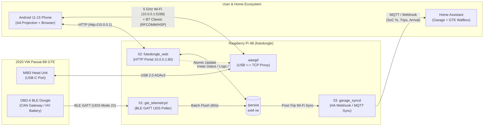

# Futedongle Next-Gen Automotive Features (`next-feats`)

This directory contains the architectural specifications and implementation blueprints for transforming **futedongle** (Raspberry Pi 4 Model B, 8 GB RAM, 64 GB microSD) from a dedicated Wireless Android Auto bridge into an integrated automotive telemetry, diagnostics, and smart-garage platform for the **2020 Volkswagen Passat B8 GTE (Facelift, MIB3)**.

---

## 1. Guiding Architectural Principles

1. **Android Auto Real-Time Priority (Zero Jitter Contract)**:
   - The core daemon (`/usr/bin/aawgd`), `hostapd` (5 GHz Channel 36), `bluetoothd`, and `dnsmasq` own the critical path.
   - All auxiliary daemons introduced in `next-feats` must run with lowered CPU scheduling priority (`nice -n 10` or `SCHED_BATCH`) and I/O priority (`ionice -c 3`) so they never contend with USB-to-TCP H.264 video or PCM audio forwarding on the power-capped 2-core 600 MHz Cortex-A72 profile (`maxcpus=2`, `arm_freq=600`).
2. **Strict Power Budget Compliance (< 2.5 W Peak)**:
   - No high-draw USB peripherals may be attached to the Pi 4 host ports when powered directly from the MIB3 front USB-C port.
   - All vehicle communication uses the onboard Cypress **CYW43455** Bluetooth 5.0 / Wi-Fi combo chip.
3. **Flash Media Longevity (Power-Loss Safe Storage)**:
   - `/boot` (`/dev/mmcblk0p1`, FAT16) and `/` (`/dev/mmcblk0p2`, ext4) remain strictly **read-only (`ro`)** during normal operation.
   - All telemetry buffers are accumulated in RAM (`/tmp`, `tmpfs`) and flushed in bounded intervals to `/persist` (`/dev/mmcblk0p3`, ext4 with `noatime,commit=30`) or offloaded over the network.
4. **Feature Flag Isolation**:
   - Every capability is individually gated via `/boot/aawgd.conf` so any subsystem can be toggled without reflashing the SD card.

---

## 2. System Architecture Overview



---

## 3. Feature Specifications Index

| Order | Document | Feature | Primary Value |
| :--- | :--- | :--- | :--- |
| **01** | [01-obd2-gte-telemetry.md](file:///Users/futesat/Work/me/WirelessAndroidAutoDongle/next-feats/01-obd2-gte-telemetry.md) | **VW Passat B8 GTE OBD-II BLE Telemetry (`gte_telemetryd`)** | Reads High-Voltage (HV) battery SoC, cell temperatures, kW charge/discharge, 12V health, and trip efficiency via BLE GATT into `/persist`. |
| **02** | [02-local-web-portal.md](file:///Users/futesat/Work/me/WirelessAndroidAutoDongle/next-feats/02-local-web-portal.md) | **Local Web Control & Diagnostics Portal (`http://10.0.0.1`)** | Browser dashboard on `10.0.0.1` to view live logs, CPU/voltage health, GTE trip stats, and edit `/boot/aawgd.conf` without removing the SD card. |
| **03** | [03-home-garage-sync-ha.md](file:///Users/futesat/Work/me/WirelessAndroidAutoDongle/next-feats/03-home-garage-sync-ha.md) | **Home Garage Auto-Sync & Home Assistant Integration (`garage_syncd`)** | Detects home arrival, reports real GTE HV battery SoC to Home Assistant for off-peak Wallbox charging, and offloads `/persist` trip logs. |

---

## 4. Prerequisite: Expanding `/persist` on the 64 GB SD Card

By default, `aa_wireless_dongle/board/raspberrypi/genimage.cfg.in` allocates a small fixed partition for `/persist` (`/dev/mmcblk0p3`), leaving ~63 GB of the 64 GB SD card unallocated.

Before storing multi-month OBD-II telemetry archives, add an idempotent auto-expand check to `aa_wireless_dongle/board/common/rootfs_overlay/etc/init.d/S00persist` (requires `BR2_PACKAGE_PARTED=y` and `BR2_PACKAGE_E2FSPROGS_RESIZE2FS=y` in `raspberrypi4_defconfig`):

```sh
# Expand /dev/mmcblk0p3 (/persist) to 100% of remaining SD card space on first boot
if [ ! -f /persist/.expanded ] && [ -x /usr/sbin/parted ] && [ -x /usr/sbin/resize2fs ]; then
    /usr/sbin/parted -s /dev/mmcblk0 resizepart 3 100% && \
    /usr/sbin/resize2fs /dev/mmcblk0p3 && \
    touch /persist/.expanded
fi
```

---

## 5. Recommended Implementation Order

1. **Phase 1 — Local Web Portal (`02-local-web-portal.md`)**:
   - Fastest to build and immediately eliminates the need to physically remove the SD card from the Passat glovebox/console to inspect `/boot/car_debug.log` or tweak `/boot/aawgd.conf`.
2. **Phase 2 — OBD-II BLE Telemetry (`01-obd2-gte-telemetry.md`)**:
   - Pairs with a BLE OBD-II adapter in the Passat's driver-side footwell diagnostic port, exposing live GTE hybrid metrics directly in the Phase 1 Web Portal and logging trips to `/persist`.
3. **Phase 3 — Home Garage Sync & Home Assistant (`03-home-garage-sync-ha.md`)**:
   - Connects the Phase 2 GTE battery & trip dataset to Home Assistant upon arriving home to automate garage entry and off-peak EV charging.

